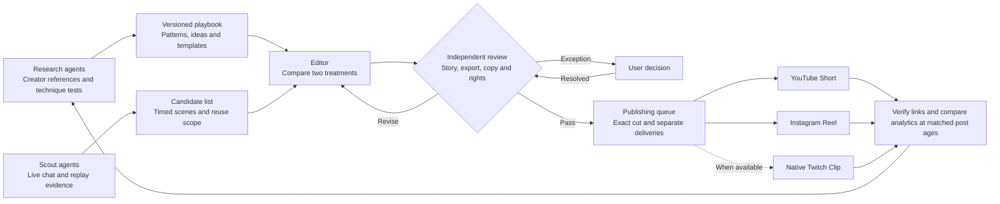

# After the Spike production plan

**Status**: approved on November 19, 2026. Implement in the verified merge sequence below.

Run After the Spike like a small GTA VI editorial studio. Learn from specific creative work, choose scenes with a reason to watch, and verify what viewers actually receive. Research, scouting, and editing can advance while a previous cut is being published or measured.

## Workflow

## Stage contracts and self-verification

| Stage | Working output | Self-verification and failure path |
| --- | --- | --- |
| **1. Research and maintain the idea bank** | A Markdown entry names a specific creator post, the part worth studying, observable evidence, the edit technique, and an original way to test it. Use the [timing experiment guide](short-form-experiments.md) to distinguish edit rhythm, time to publish, and time of day. | Reopen the original source and confirm the creator, URL, and observed frames. Record audio, exact timing, or performance as unknown when they cannot be seen or heard. A second agent checks at least three actual posts across two accounts before a new technique goes into the playbook. A promising idea stays a hypothesis until it works on another scene. |
| **2. Scout and select** | A candidate names the creator, replay or recording, the clock and source range, chat baseline and cue if applicable, observed setup and payoff, and reuse scope per destination. Scout three suitable creators when live. Use the existing live and archive tools and keep fees, permissions, and raw source evidence local. | Match the cue and footage on their original clock. Replay the same chat file to reproduce the count and baseline. Inspect the footage around the cue. Check for coverage of the setup, payoff, and reaction, plausible use of the creator's footage, and a distinct story from recent posts. Reject a cue when the visible moment, permission, or alignment fails. Log the reason. |
| **3. Prepare two editorial treatments** | One clear premise, timecoded beats, a first cut, and one controlled revision. Use simple FFmpeg edits when the footage carries the story, Resolve for a layered native timeline, or Instagram Edits for a useful social variant. Borrow the [FootagePilot review workflow](editing-toolkit.md) and prove a reusable treatment with replacement media before retaining it as a template. | Compare the opening, framing, and payoff in both versions. Save frame strips around cuts and overlays and review the moving export at phone size and on mute. With authorized audio, check timing, gain, silence, waveform, and spectrum in the exported file. Listen where available. Measurements cannot establish intelligibility, meaning, or taste. Run a format probe and full decode on the chosen export. Confirm native timeline and render receipts when claiming a native export. |
| **4. Independently review the delivery** | A reviewer different from the editor records why this is worth sharing, the exact export hash, evidence of what improved, audio and disclosure choices, platform-specific title and caption, creator credit, source permission, and the single experiment to measure. | Reviewer identifies the scene without project context, confirms the edit lands the intended beat, and verifies that copy adds a human observation and leaves the relevant payoff in the clip. Recheck artifact and metadata on enqueue. Send the cut back for revision when it fails. The user has chosen agent review for routine releases with human decisions for exceptions. Unclear rights, unidentified accounts, new permissions or terms, and unexplained publish outcomes go to the user when the agent cannot resolve them independently. |
| **5. Queue and publish** | A local SQLite queue stores a reviewed cut revision and separate statuses for YouTube and Instagram. Native Twitch publication is optional when the channel and player allow it and gets its own receipt. An authenticated publisher processes one delivery at a time while other agents work on other cuts. | Test duplicate submission of the same package, conflicting revisions, a changed asset, two claimants, and an expired claim. Before a live action verify the account, approved media hash, and saved copy. Persist the publication attempt before the first platform mutation. Open the returned permalink and read back visibility, account, and caption before marking verified. Test an ambiguous timeout and a partial two-platform result. Reconcile drafts and public posts against the account before any retry. |
| **6. Measure and feed back** | A per-platform receipt records the public timestamp, permalink, edit time, cue-to-post time, and any separately verified campaign status. Collect opening hold, retention or watch time, shares, and views where available. | Use actual publication age and platform definitions. Compare similar scenes and lengths at comparable ages, for example 24 hours, 72 hours, and seven days. Keep unavailable values blank. Record what changed and plausible confounders. Require repetition on an independent scene before calling it an improvement. Promote the lesson with evidence or revise the next test. |

## Parallel work and recovery

- Research agents own separate Markdown files. Scout agents own source windows, observations, and rejected candidates. Editors produce immutable revisions. A reviewer approves the exact export and packaging. The publisher owns the browser and platform receipts. One PR owner checks diffs and merges. No two workers edit the same file or touch a shared browser concurrently.
- Keep chat exports, media, projects, frame evidence, SQLite state, and credentials local. Commit the playbook, code, synthetic fixtures, and concise evidence summaries. Start with one media-heavy render at a time on this Mac. Reuse a single Brave task tab for publishing, check memory, and use the installed OneTab workflow for eligible finished tabs.
- Use the queue's lease only to coordinate work. A worker must stop making external changes when its lease expires. Work claimed before any platform mutation can return to ready. A publishing operation with uncertain outcome stays in reconciliation. A verified YouTube delivery stays verified if Instagram needs recovery. An external receipt is required even if an upload command or browser click returns success.
- Preserve the existing producer formats. `live_clipper.py` emits timestamped cues and `clip_finder.py` emits trim/export manifests. Archive reports use VOD offsets. A handoff names the source clock so the queue never treats replay seconds as Unix time.

## Implementation and merge sequence

Each PR has one independently useful outcome. Before merging, check its diff, run `python3 -m unittest discover -s tests -v`, run the pinned VOD suite for detector or boundary changes, and read back the merged commit on `origin/main`. Show the negative or recovery test as well as the successful path.

1. **Editorial foundation and copy recovery.** Complete the existing [PR #22](https://github.com/archit15singh/chat-clip-finder/pull/22) with the reviewed plan, creator research, timing research, and FootagePilot audit. Preserve the current browser resource guidance. Finish and verify outstanding caption edits before publishing another cut. **Exit evidence**: Research links resolve and claims match the source. Native editor capabilities are qualified. Updated captions are read back in the right accounts. Code behavior is unchanged.
2. **Verified edit artifacts.** Add a local review runner and reusable storyboard/review template. Use the established FootagePilot commands for richer native workflows, and produce export metadata, timestamped frames, optional audio measurements, and an artifact hash. Keep assets and upstream code outside this repo unless use is established. **Exit evidence**: Exercise valid portrait exports with and without audio, a corrupt or wrong-format file, and a revision that changes a visible beat. Inspect the actual output images and any audio evidence. Record what is and is not verified for Resolve and Edits.
3. **Durable handoff and publisher queue.** Finish the existing draft of `studio_queue.py` with validated source identity and revision evidence, review binding, exclusive publisher claims, and per-destination reconciliation. Add a documented local handoff from the existing scout and render commands. **Exit evidence**: End-to-end fixture stages a cut, exercises the review gate, races two independent workers, recovers an expired lease, catches a modified artifact, and retains one verified delivery when another needs reconciliation.
4. **First live round through the queue.** Run research and scouting in parallel, select one fresh eligible scene, compare two edits, and let a separate agent review it. Publish via the verified accounts with one browser tab and record links and receipts. **Exit evidence**: Exact approved export and copy match both public posts, with native Twitch receipt or a specific reason it was unavailable. Account identity, rights and any campaign terms were checked.
5. **Repeat with feedback.** Make matched-age readback and playbook updates part of the agent brief. Run a second independent scene through the workflow, using one deliberate improvement from the first round. **Exit evidence**: The comparison explains what changed, links the evidence and gives a qualified result. The next agent can pick up the queue and evidence without reconstructing the earlier session.

The queue is a local coordination tool. It does not need a hosted service or an unattended posting daemon for the first release. Extend the publishing integration only after the reviewed browser path, account readback, and recovery behavior are proven.
